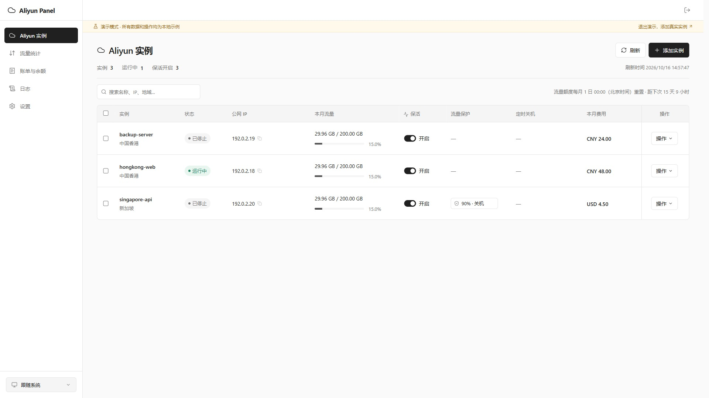

# Aliyun Panel

[](https://github.com/haoch1/aliyun-panel/actions/workflows/ci.yml)
[](LICENSE)
[](https://nodejs.org/)
[](https://github.com/haoch1/aliyun-panel/pkgs/container/aliyun-panel)

面向阿里云 ECS 的自托管管理面板，提供实例保活、月度共享流量保护、每日定时开关机、账单与余额查询，以及 Telegram 通知

前端采用 React，服务端采用 Node.js，使用 SQLite 保存配置、任务、监控历史和日志，无需独立数据库或消息队列

## 功能

| 模块       | 能力                                                                                             |
| ---------- | ------------------------------------------------------------------------------------------------ |
| 实例管理   | 按实例接入多个 RAM 凭证与地域，展示状态、公网 IP、月度流量及费用，支持单台和批量开关机           |
| 实例保活   | 检测意外停止并提交启动请求，核实运行状态后记录结果，人工停机、流量保护和计划停机时段约束自动启动 |
| 流量保护   | 按共享额度百分比或绝对流量设置阈值，支持关机并通知、仅告警，以及可选的流量恢复后自动启动         |
| 定时开关机 | 每日运行时段、跨午夜计划、时区与夏令时处理，服务恢复后按当前时段补偿检查                         |
| 流量统计   | 本月、近 7 天、近 30 天的实例公网入站、出站及合计流量，鼠标跟随提示、每日明细与历史增量缓存      |
| 账单与余额 | 国内站和国际站 BSS 端点、月度实例税前金额、余额缓存及独立错误处理                                |
| Telegram   | 14 类可选通知、每日汇总、消息示例与频率说明，持久化投递队列、失败重试与限流退避                  |
| 日志       | 检测快照分列显示状态、流量、保活和费用，记录规则判断、动作阶段、请求 ID 与通知投递结果           |
| 访问控制   | 管理员登录、会话期限、登录限速、CSRF 校验，凭证加密存储                                          |



## Docker 部署

镜像：`ghcr.io/haoch1/aliyun-panel:latest`，支持 Linux amd64 和 arm64

在空目录中创建 `compose.yaml`：

```yaml
name: aliyun-panel
services:
  aliyun-panel:
    image: ghcr.io/haoch1/aliyun-panel:latest
    container_name: aliyun-panel
    hostname: aliyun-panel
    restart: unless-stopped
    ports:
      - "127.0.0.1:4182:4182"
    environment:
      HOST: 0.0.0.0
      PORT: 4182
      DATA_DIR: /app/data
      PUBLIC_ORIGIN: ""
    volumes:
      - aliyun-panel-data:/app/data
    cap_drop:
      - ALL
    security_opt:
      - no-new-privileges:true
volumes:
  aliyun-panel-data:
    name: aliyun-panel-data
```

```sh
docker compose up -d
docker compose logs -f aliyun-panel
```

在部署主机访问 `http://127.0.0.1:4182`，首次进入时设置管理员密码，随后添加实例与 Telegram 配置

默认端口仅绑定主机回环地址，远程访问可使用 SSH 隧道或配置 HTTPS 反向代理：

```sh
ssh -L 4182:127.0.0.1:4182 user@server
```

使用仓库内的 Compose 时，可通过 `PANEL_PORT`、`PANEL_BIND`、`PANEL_IMAGE` 调整宿主机端口、绑定地址和镜像版本；反向代理、更新、备份及源码部署见 [部署文档](docs/deployment.md)

## 接入与权限

1. 在阿里云 RAM 创建专用用户，启用 AccessKey，并授予所需策略
2. 在面板选择“添加实例”，填写 AccessKey、账号所属站点及指定 ECS 实例 ID
3. 查询并确认目标实例，选择地域后添加
4. 配置实例保活、流量保护和每日计划；在设置页配置检测间隔及通知

**账号所属站点与实例地域是两个独立概念**：国际站账号选择 `alibabacloud.com`，国内站账号选择 `aliyun.com`；香港实例不代表账号必须选择国际站

| 系统策略                  | 使用场景                                                         |
| ------------------------- | ---------------------------------------------------------------- |
| `AliyunECSFullAccess`     | ECS 信息查询、固定公网监控，以及保活、流量保护、定时和手动开关机 |
| `AliyunCDTReadOnlyAccess` | 月度共享流量与阈值判断                                           |
| `AliyunBSSReadOnlyAccess` | 实例账单与账号余额                                               |
| `AliyunEIPReadOnlyAccess` | 独立 EIP 的每日流量图表，仅使用此类公网 IP 时需要                |

ECS 全权限策略范围大于面板实际调用范围；需要限制到指定实例时，可改用 [受限 ECS 策略模板](docs/ram-ecs-policy.template.json)。授权步骤、操作清单和资源范围见 [RAM 权限说明](docs/ram-permissions.md)

面板仅使用保存的 AccessKey 签名请求，不继承浏览器中登录主账号的身份，不调用创建、购买、续费或释放资源接口

## 自动化行为

- 默认开启实例保活，默认检测间隔为 60 秒；若实例在两轮检测之间停止，需等待后续检测及云端启动完成
- 流量保护默认未启用；启用后默认阈值为 90%，默认执行关机并通知，停机模式为普通停机 `KeepCharging`
- 流量保护触发后会阻止保活自动启动；“流量恢复后自动开机”默认关闭，启用后仍需满足本月流量有效、低于阈值、计划允许及无人工停机限制
- 定时开关机默认未启用，默认时间为 08:00–23:00、时区为 `Asia/Shanghai`；计划停机期间保活不启动实例
- 手动停机会设置人工停机限制，避免保活立即重启；手动启动可解除该限制
- 较长检测间隔不限制月初检查、定时边界、手动刷新和已提交动作的结果核实，这些情况仍可能产生额外读取请求
- 实例页“刷新”会触发检查并执行已启用规则，浏览器关闭后后台调度仍持续运行

完整优先级、停机计费和恢复条件见 [自动化说明](docs/automation.md)

实例列表、实例选择器和账单明细按名称自然升序排列，例如 CDT1、CDT2、CDT10；同名实例按地域、实例 ID 和接入账号固定次序，刷新与异步查询不会改变排序。实例页将流量保护与定时关机分别展示

## 流量与账单口径

月度阈值使用 **账号共享流量池**，并按中国内地与非中国内地分别统计；同一账号、同一流量池的多台实例会显示相同月度流量，不能逐行累加

每日图表使用 **所选实例的公网监控数据**：固定公网 IP 查询 ECS，独立 EIP 查询 VPC。该图表与账号共享月度流量的统计范围、延迟和更新时间不同，不能直接相互替代

界面统一显示 KB、MB、GB，内部以字节保存并按 1024 进位格式化；绝对流量阈值采用相同换算。缺失监控数据保持为空，不按零用量参与启动判断

账单金额为所选账期的实例税前金额，余额为账号余额；同一账号余额在多台实例行中重复展示，不能汇总相加。账单查询失败不会阻断 ECS 状态与流量保护检查，已有成功数据会标记为缓存

## 通知默认项

默认勾选保活开机、流量关机、开关机异常、检测异常、账单查询异常和每日汇总；每日汇总默认在北京时间 00:00 发送，每轮汇总默认关闭

通知标题统一使用三色圆点：🟢 表示动作成功、恢复、汇总及测试通知，🟠 表示告警及非异常状态变化，🔴 表示异常或失败。Telegram 消息、通知示例和最近通知使用相同规则

各通知的内容、触发条件、去重与重试规则见 [Telegram 通知](docs/notifications.md)

## 数据与安全

- 默认数据目录为 `data/`；容器内为 `/app/data`，使用非 root 用户运行
- SQLite 文件 `panel.sqlite` 与加密密钥 `encryption.key` 必须共同备份；使用环境变量密钥时，应单独保存该密钥
- 监控历史保留 93 天；系统日志最多保留最近 5,000 条，超出后自动删除最早的记录，各日志类型共用此上限
- 日志每页支持显示 20、50 或 100 条，默认 20 条，浏览器记住条数选择；切换筛选条件或每页条数时返回第一页
- 管理员密码采用 scrypt 哈希，AccessKey Secret 与 Telegram Token 使用 AES-256-GCM 加密
- 数据目录、密钥、运行日志和真实环境配置不包含在源码或镜像中
- 面板无需购买额外云服务；已有 ECS、磁盘、公网 IP 和流量的费用仍按阿里云计费规则结算，普通停机不会停止全部计费
- 保活依赖面板服务、网络、权限及云端库存，不能阻止抢占式回收、欠费释放或到期释放

## 开发与构建

要求 Node.js 24.5+、pnpm 11.25.0

```sh
git clone https://github.com/haoch1/aliyun-panel.git
cd aliyun-panel
pnpm install --frozen-lockfile
pnpm check
pnpm test
pnpm build
pnpm start
```

`pnpm dev` 启动本地前后端开发服务；`/?demo=1` 提供浏览器内模拟数据，演示操作不访问阿里云，刷新页面会重置演示状态

测试使用模拟云端接口和本地 Telegram HTTP 服务，覆盖策略判断、调度、动作结果、权限错误、账单缓存、流量查询、通知和前端数据缓存，不使用真实 AccessKey 或 Telegram Token

GitHub Actions 在每次推送、Pull Request 及手动触发时执行类型检查、测试与前端构建；主分支和版本标签通过容器验证后发布 GHCR 多架构镜像。主分支更新 `latest`，版本标签 `vX.Y.Z` 发布 `vX.Y.Z` 与 `X.Y.Z`，同时保留完整提交标识 `sha-<commit>`

## 文档

- [部署、更新与备份](docs/deployment.md)
- [自动化与调度](docs/automation.md)
- [RAM 权限](docs/ram-permissions.md)
- [Telegram 通知](docs/notifications.md)
- [故障排查](docs/troubleshooting.md)
- [API 与查询机制](docs/api-implementation.md)

## 许可证

本项目采用 [MIT License](LICENSE)
